  

  

 

  
  
  

---

## Muhammad Najib Pradana

**Software Engineering Manager & Full-Stack Developer**
Lulusan S1 Teknik Komputer Universitas Diponegoro (UNDIP). Berfokus pada rekayasa perangkat lunak kustom *end-to-end*, perancangan skema basis data relasional, serta kepemimpinan tim teknis lintas fungsi (PM dan programmer) dalam siklus SDLC.

- **Peran Saat Ini:** Ketua Divisi Custom Program / Project Manager & Full-Stack Developer
- **Pendidikan:** S1 Teknik Komputer — Universitas Diponegoro (2022–2026)
- **Ekosistem Utama:** Next.js (App Router), TypeScript, Tailwind CSS, Prisma ORM, Laravel & Filament PHP
- **Spesialisasi:** Arsitektur RBAC & Alur Dokumen, Enterprise Admin Portal, E-Commerce, dan Computer Vision (YOLOv8)
- **Domisili:** Jawa Tengah, Indonesia (Terbuka untuk On-Site, Hybrid, & Remote)

---

## Sistem Produksi & Studi Kasus Utama

| Sistem / Proyek | Domain & Instansi | Stack & Arsitektur | Dampak & Hasil Terukur |
| :--- | :--- | :--- | :--- |
| **NIMS Insurance Portal** | Enterprise Workflow — *Baskoro Tech / Bank Mandiri KCP Sutomo* | Laravel, Filament PHP, Relational ERD, RBAC | Otomatisasi alur pengajuan, verifikasi berjenjang, dan pengelolaan polis/klaim asuransi pada portal user & admin. |
| **RADARS** | GovTech Archival — *Dinas Arsip & Perpustakaan Kota Semarang* | Backend Engineering, Relational DB, Web App | Digitalisasi rekap data arsip internal daerah; memperoleh tindak lanjut resmi deployment dari **DISKOMINFO**. |
| **SmarTik** | Applied Computer Vision — *Riset Terapan Teknik Komputer* | Python, YOLOv8, CNN, PyTorch, OpenCV | Deteksi dan klasifikasi motif Batik Semarangan secara real-time melalui antarmuka web. |
| **Sigur.id & Portal UMKM** | E-Commerce & Retail — *Baskoro Tech & KKN-T 106 UNDIP* | Next.js, Front-End Architecture, Admin CMS | Peluncuran etalase produk dan dashboard admin mandiri untuk perluasan pemasaran UMKM lokal. |
| **Next.js Scaffold Engine** | Developer Tooling — *Internal Engineering Standard* | Shell Script, Next.js 16, Tailwind v4, Prisma | Otomatisasi inisialisasi proyek baru lengkap dengan struktur modular dan design token OKLCH dalam hitungan menit. |

---

## Fokus Rekayasa & Kepemimpinan Teknis

- **Arsitektur Sistem & Kontrol Akses (RBAC):** Merancang struktur folder modular, pemisahan layer layanan, dan skema otorisasi multi-peran sebelum penulisan kode dimulai.
- **Standarisasi & Otomatisasi (Reusable Blueprint):** Mengonsolidasikan pola produksi Next.js, Tailwind CSS, dan Prisma ORM menjadi generator scaffold standar bagi tim developer.
- **Manajemen Tim & SDLC Terukur:** Memimpin perencanaan sprint mingguan, pemetaan alur kerja klien, dan sinkronisasi tugas antara Project Manager dan programmer.
- **Operasional & Infrastruktur:** Mengelola layanan verifikasi **500+ berkas Hak Cipta (HAKI)** di Direktorat Inovasi UNDIP serta berpengalaman sebagai Asisten Praktikum pada 3 laboratorium jaringan dan pemrograman (Switching/Routing Ethernet, Jaringan Komputer TCP/IP, dan Dasar Pemrograman).

---

## Tech Stack

**Frontend & Interactive Web**

**Backend & Database**

**AI, Computer Vision & DevOps**

---

## Aktivitas & Statistik Repositori

  
  

